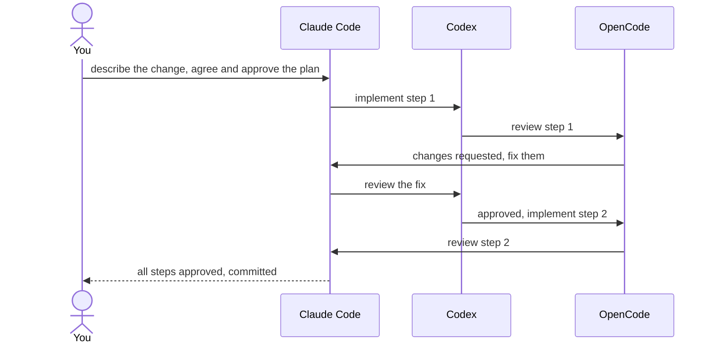

# Herdr Harness Relay

Harness Relay passes a coding change between several AI coding tools inside [Herdr](https://herdr.dev), like a baton in a relay race. You describe the change to the first tool and approve its plan. Relay then hands each task to the next tool to implement, the one after that to review, and keeps rotating. When everything is reviewed, Relay commits the result.

A few words used throughout:

- **Harness**: an AI coding tool such as Claude Code, Codex or OpenCode.
- **Relay**: one complete change, from your first message to the commit.
- **Baton**: whose turn it is. It moves to the next harness at every step, so no harness reviews its own work.



The example uses three harnesses. With two, they simply alternate. Optional design-review and second-opinion steps, when the planner asks for them, take the next turns before task 1.

## Quick start

You need Herdr `0.7.3` or newer, Node.js `20` or newer, a git repository for your project, and at least two harnesses that are installed and signed in.

```sh
herdr plugin install dsmailes/relay
```

Open a Herdr workspace at your project, then run this in any terminal pane:

```sh
herdr plugin action invoke community.harness-relay.open-relay
```

On first run Relay lists the harnesses it found on your `PATH` and suggests a rotation. Press **Enter** to accept it, or type the names or numbers you prefer. Relay then opens the first harness in a new tab. Tell it what you want changed, agree a plan, and approve it. Relay takes over from there.

Next time the only prompt is "Press Enter to start". Type `change` there to pick different harnesses.

Optional keyboard shortcut. Plugins cannot register keys themselves, but you can add this to Herdr's `config.toml`:

```toml
[[keys.command]]
key = "prefix+r"
type = "plugin_action"
command = "community.harness-relay.open-relay"
description = "Harness Relay"
```

## What you will see

Relay keeps its input console separate from the active harness. During a run, it opens a read-only activity pane beside the current harness and refreshes it as the baton moves.

```text
┌─ Relay console ─────────────────────┐   ┌─ Relay Activity ──────────────────────┐
│ waiting for the approved plan       │   │ Insurance report [TASK-016]           │
│                                    │   │ ✓ Claude · plan · approved             │
│                                    │   │ ● Codex · implement · PDF renderer    │
│                                    │   │   active                               │
└────────────────────────────────────┘   └────────────────────────────────────────┘
                                             ┌─ active harness: Codex ─────────────┐
                                             │ talk here if it asks a question      │
                                             └──────────────────────────────────────┘
```

- **The Relay console** starts and resumes a run and handles its prompts. It is not a separate coordinator harness.
- **The activity pane** is read-only. It shows the change, the harness rotation, completed and active steps, and each step's summary. It refreshes at every baton pass and follows the active harness tab.
- **The harness pane** is where you talk to the current harness. Relay closes the previous harness tab when the next harness starts, so only one harness pane is active at a time.
- Recognized harnesses get distinct icons. At completion the panel shows a podium; token ranks are marked unavailable until Herdr provides measured token totals.

A typical relay:

1. You talk to the first harness until the plan is right, then approve it. (Relay knows you approved because the harness hands it the plan.)
2. Relay hands out implementation steps. You can watch, or leave. If a harness needs a permission or answer, Relay sends a notification and waits for you in that harness's tab.
3. When every implementation step is reviewed and approved, Relay commits the result and the baton returns to the first harness for your next change.

If an implementer reports `blocked`, Relay marks that subtask and its parent ticket `blocked` while it waits for you. When implementation resumes, Relay returns both tickets to `in progress` and records the handoff summary.

## Safety: what Relay touches

- **Harnesses edit your real working directory**, with whatever permissions you have given them. There is no separate copy or worktree. Start from a clean or committed state when you can.
- **Relay commits once per finished relay**, on your current branch, containing only the files the relay changed. It never pushes. Hooks run normally, and Relay never bypasses them.
- **Relay skips the commit, and says why,** if it cannot do it safely: you had uncommitted edits in a file the relay also changed, HEAD moved during the run, HEAD is detached, a merge or rebase is in progress, a hook rejected it, or the folder is not a git repository. Your work stays in the working tree.
- **Your other uncommitted work is never swept into the commit.** To turn automatic commits off, set `"autoCommit": false` in `harnesses.json` in the plugin config directory (`herdr plugin config-dir community.harness-relay`).
- **Checkpoints.** After each approved task Relay also saves a hidden commit under `refs/relay/<run>/task-N`. They never move your branch, and you can diff against or restore from them.
- Relay adds `.herdr-issues.json` to your local `.git/info/exclude` so the ticket board does not clutter `git status`.

## Watching progress

Relay keeps three records, all updated as it goes.

| Where | What it holds |
| --- | --- |
| The Harness Relay tab | The live checklist above |
| The Livestock board | The matching parent ticket for the change, with linked implementation steps, baton passes, summaries and review findings |
| The plugin state directory | An append-only log of every step across all runs, a snapshot of each finished run, and the exact diffs reviewers saw |

**Livestock** is an optional separate Herdr plugin that displays `.herdr-issues.json`. With it installed, press `prefix+i` in your project's workspace to open the live board beside your panes; it updates as tickets move. Without Livestock Relay still works, and the JSON file is there to read.

When the approved request names an existing ticket key (for example, `TASK-016`), Relay attaches its implementation steps to that ticket instead of creating a duplicate parent. The live board shows those steps nested under the parent. Progress messages and the final commit identify the parent request; an individual step being approved does not mean the whole ticket is complete.

The state directory is `~/.local/state/herdr/plugins/community.harness-relay/` (the path Herdr passes to Relay as `HERDR_PLUGIN_STATE_DIR`). Its files are named by a short hash of your project path: `<key>.json` (current run), `<key>.events.jsonl` (the log), `runs/<run>.json` and `diffs/*.patch`.

## Stopping and resuming

Every step's result is saved, so you can close the tab, lose power, or hit an error and carry on. Run the action again and press **Enter** at "resume this run". Relay re-reads the waiting harness's tab instead of resending its prompt. If that tab is gone, it starts a fresh harness and resends.

When something needs you, the Harness Relay tab shows a menu:

- **Enter**: keep waiting.
- `resend`: send the prompt to the harness again.
- `stop`: exit and keep everything for later.

After three review rounds on one task you can also choose `more` rounds, or `accept` the work as it is.

Only one Relay can run per project at a time. If a crash left a stale lock, Relay notices the dead process and clears it.

## Troubleshooting

**I approved the plan and nothing happened.** Open the Harness Relay tab: it should say it is waiting on the harness. If you are on an older install, update the plugin, stop the coordinator tab with `Ctrl+C`, run the action again and press Enter to resume. Very long plans were not recognised by early versions.

**"Saved run was made by an older Relay version."** Type `new` to drop it. Anything it already changed stays in your working tree, so check `git status` first.

**The action is missing.** Run `herdr plugin list` and `herdr plugin action list --plugin community.harness-relay`. If it is absent, install again. To run from a local checkout use `herdr plugin link /path/to/relay` (if the plugin is already linked, `install` will refuse; the link is already enough).

**A harness does not start.** Check it works in a normal terminal and is signed in. Relay waits up to three minutes (first-run dialogs can be slow), then shows the menu.

**A step seems stuck.** Look at the active harness tab. If it is waiting on a permission or a question, answer it there and Relay continues. A harness that stops without handing off gets one reminder from Relay.

**"Could not resolve the project directory."** Run the action from the workspace you want to change.

**"Not committed: …"** The reason follows. Commit the files yourself when ready.

## Reference

### Supported harnesses

Rotation follows this order. Herdr must recognise the kind, and the program must be installed. Relay does not install or sign in harnesses.

| | | | |
| --- | --- | --- | --- |
| Claude Code `claude` | Codex `codex` | OpenCode `opencode` | GitHub Copilot CLI `copilot` |
| Pi `pi` | Gemini CLI `gemini` | Cursor Agent `cursor` | Amp `amp` |
| Droid `droid` | Kimi Code `kimi` | Kiro CLI `kiro` | Cline `cline` |
| Devin CLI `devin` | Antigravity CLI `agy` | Hermes Agent `hermes` | Kilo Code CLI `kilo` |
| Qoder CLI `qodercli` | Qwen Code `qwen` | MastraCode `mastracode` | Grok CLI `grok` |
| OMP `omp` | Maki `maki` | Letta Code `letta` | Muse `muse` |

### How hand-offs work

Each step starts a fresh harness session, so Relay gives it everything it needs: the agreed brief, the task and acceptance criteria, the ticket history, and for reviewers the exact diff of that task. Reviewers see only that task's changes, not your other work. They come from snapshots taken before and after each task, without touching your index, branch or HEAD.

Relay also tells each harness to read applicable project instructions, discover skills available to that harness, and invoke the relevant ones using its native skill mechanism. Skill availability can differ between harnesses; Relay does not install skills. For TCA work, prompts specifically direct harnesses to look for applicable Point-Free/pfw skills, such as Composable Architecture, dependencies, testing, SwiftUI, or navigation guidance. Implementers and reviewers report the skills they used (or any availability limitation) in their hand-off, which Relay records in the run history and Livestock ticket.

A harness finishes each step with one **hand-off line** that Relay reads from its tab. Every prompt gets its own random token so old output is never mistaken for a new answer.

| Step | Hand-off line |
| --- | --- |
| Plan (first harness) | `RELAY_PLAN_<token>: {"title":…,"request":…,"approvedByUser":true,"needsDesignReview":…,"needsSecondOpinion":…,"tasks":[…]}` |
| Plan approval after revision | `RELAY_APPROVAL_<token>: {"decision":"approve","tasks":[…]}` |
| Revised plan | `RELAY_REVISED_PLAN_<token>: {"tasks":[…]}` |
| Design review | `RELAY_DESIGN_<token>: {"recommendations":…}` |
| Second opinion | `RELAY_OPINION_<token>: {"decision":"approve"}` or `{"decision":"revise","findings":…}` |
| Implementation | `RELAY_IMPLEMENTATION_<token>: {"status":"complete"\|"blocked","summary":…, "skillsUsed":[…], "skillNote":…}` |
| Review | `RELAY_REVIEW_<token>: {"decision":"approve"}` or `{"decision":"changes","findings":…}`, with `skillsUsed` and `skillNote` |

If a harness answers in the wrong shape, Relay says what was wrong and asks again, up to three times. A plan has 1 to 20 tasks, each with a `title` and `acceptanceCriteria`. Because later harnesses never see your conversation, the planner writes `request` as a self-contained brief, and the better that brief is, the better the later steps do.

### Development

Dependency-free Node.js.

- `src/relay-console.mjs`: the coordinator (step runner, pause menu, task loop, final commit).
- `src/steps.mjs`: prompts and answer validation for every step.
- `src/markers.mjs`: hand-off line parser.
- `src/gitdiff.mjs`: snapshots, diffs, checkpoints and the final commit.
- `src/board.mjs`: locked Livestock board updates.
- `src/store.mjs`: state, event log, run history, project lock.
- `src/harnesses.mjs`: harness list and PATH detection.
- `src/herdr.mjs`: Herdr CLI helpers.

```sh
npm test
```

The suite includes an end-to-end test that drives the real coordinator against a fake `herdr` binary (`test/fake-herdr.mjs`), including a kill and resume mid-review and the final commit. It does not exercise real harnesses.
